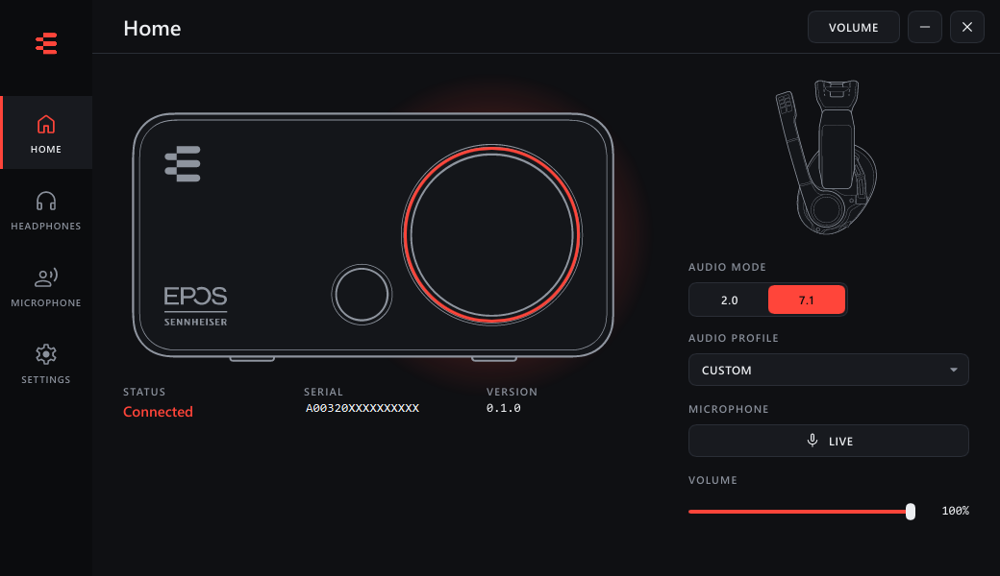
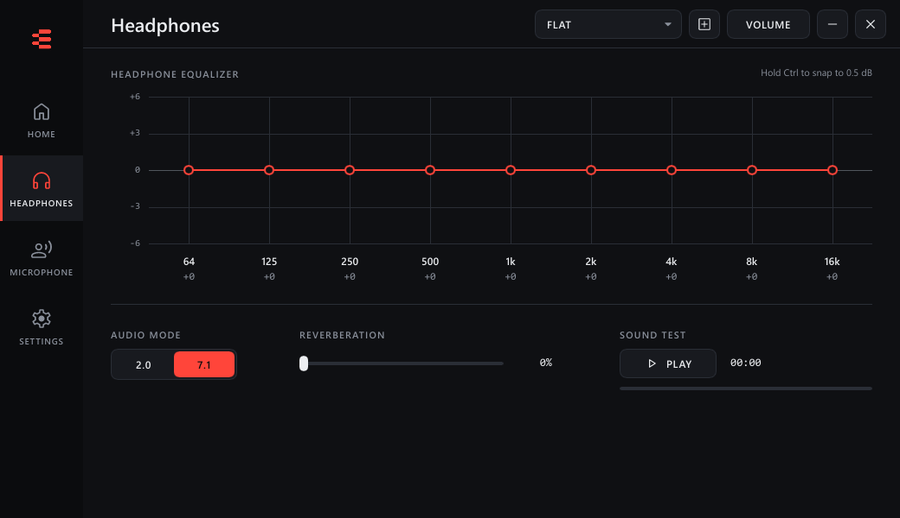
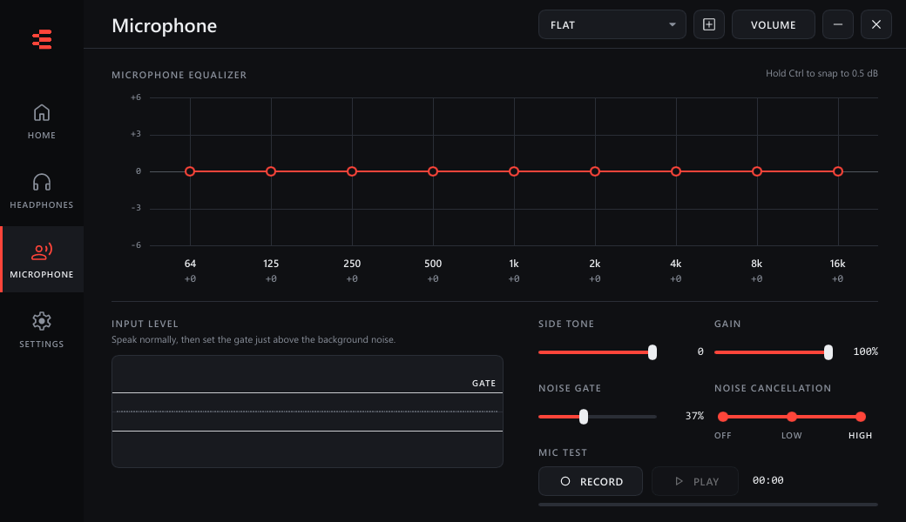

# EposControl

A fast, light, open replacement for EPOS Gaming Suite. Pure native Rust, no web view: about 8 MB on disk and a few MB of memory while it sits in the tray.





## Supported hardware

**Only the EPOS GSX 300 (USB 1395:0098) is supported.** Everything here was reverse engineered from that one device.

Other EPOS and Sennheiser models that use the same EPOS audio driver could potentially work, but they are **untested** and may need changes. The device specific parts are small:

- `crates/epos-device/src/lib.rs`: USB VID and PID, and the HID reports for the smart button, knob light and side tone.
- `crates/app/src/apo.rs` and `crates/app/src/service.rs`: the names of the shared memory objects, which end in `_<VID>_<PID>`.
- `docs/RE_NOTES.md`: the protocol, the memory layout and how it was found.

Reports and patches for other models are welcome.

## Platforms

| Platform | Download | What works |
|---|---|---|
| Windows 10 and 11 | `EposControl-Setup-<version>.exe` | Everything. This is the supported build. |
| Linux (x86_64) | `EposControl-<version>-linux-x86_64.tar.gz` | The window and the hardware features: smart button, knob light, side tone. **Experimental and untested on real hardware.** |
| macOS (Apple silicon and Intel) | `EposControl-<version>-macos-universal.zip` | Same as Linux. **Experimental and untested on real hardware.** |

The equalizer, 2.0 and 7.1 surround, reverberation, noise gate, noise cancellation and the microphone effects run inside the EPOS audio driver, which only exists on Windows. On Linux and macOS those controls are shown but do nothing, and there is no tray icon: closing the window quits the app.

Linux needs a udev rule so your user can talk to the device. Copy `70-eposcontrol.rules` from the archive to `/etc/udev/rules.d/`, then run `sudo udevadm control --reload-rules && sudo udevadm trigger` and replug the device. On macOS the app is not signed, so open it with right click, Open the first time.

## Features

- Headphones: 9 band equalizer (hold Ctrl to snap to 0.5 dB), 2.0 and 7.1 audio mode, reverberation, sound test, saved and custom profiles.
- Microphone: 9 band equalizer, gain, side tone, noise gate with a live input level, noise cancellation, record and play test, saved and custom profiles.
- Smart button: toggle audio mode, toggle audio profile or toggle mute, with a small on-screen message.
- Knob light: blue in 2.0 and red in 7.1 by default, or set it by hand. The whole interface follows the colour.
- Starts hidden in the system tray when Windows starts (optional).
- Detects the official EPOS Gaming Suite and turns off its app, service and startup entry, reversibly.

## Install

1. Download the latest `EposControl-Setup-<version>.exe` from the [Releases](../../releases) page and run it as administrator.
2. The EPOS audio driver must already be installed. Installing the official EPOS Gaming Suite once does that.
3. The first time, keep "Turn off the official EPOS Gaming Suite" and "Restart the Windows audio service" ticked.

The installer is not code signed, so Windows SmartScreen will warn you. Choose More info, then Run anyway.

Uninstalling EposControl turns the official EPOS software back on.

## How it works

The EPOS audio driver (an audio processing object) reads its settings from a block of shared memory that the official background service creates. EposControl installs a small Windows service, `EposControlHost`, that creates the same memory, and the tray app writes the equalizer, surround, reverb and microphone settings into it. Hardware features (smart button, knob light, side tone) go straight to the device over HID.

## Build from source

Needs Rust (stable, MSVC toolchain) on Windows.

```
cargo build --release -p eposcontrol
```

Run with `--minimized` to start hidden in the tray (this is what the startup entry uses).

To build the installer you also need Inno Setup 6 (`winget install JRSoftware.InnoSetup`):

```
scripts\build-installer.ps1
```

GitHub Actions builds the installer on every push, and publishes it as a release when a tag like `v0.1.0` is pushed.

## Official EPOS Gaming Suite

EposControl checks for the official software at startup, every 30 seconds while its window is open, and when the window is shown. It looks for the running app, the `EPOSGamingSuiteService` service, and startup entries (shortcuts in the Startup folders and Run registry values). If anything is active, the Home page shows a banner and Settings shows a DISABLE button. Disabling asks for admin rights once and then:

- closes the official app and stops its service, setting the service to disabled (not removed),
- renames startup shortcuts to `*.eposcontrol-disabled`,
- removes matching Run values after saving them to `%ProgramData%\EposControl\disabled-official-run.txt`.

The installer does the same (`eposcontrol.exe --disable-official`) and the uninstaller reverses it (`--restore-official`).

## Assets, trademarks and disclaimer

EposControl is an unofficial project. It is not affiliated with, endorsed by or supported by EPOS or Sennheiser. EPOS, Sennheiser, GSX and GSP and their logos belong to their owners.

- The "E" mark used for the app and tray icon, and the device drawings in `assets/gsx300-top.svg` and `assets/gsp600.svg`, were traced from official EPOS product guides. They are included to identify the hardware this works with. If you are the rights holder and want them removed, open an issue.
- Icons are Material Symbols (Apache 2.0), in `assets/icons`.
- The installer can optionally bundle the audio driver files from the official installer, but the published builds do not.

The software replaces a background service and writes to an audio driver's memory. Use it at your own risk.

## License

EposControl is licensed under the [PolyForm Noncommercial License 1.0.0](LICENSE). You can use, copy, modify and redistribute it freely for any noncommercial purpose. You may not use it, or anything derived from it, to make money in any form: no selling it, no paid products or services built on it, no ads or paid features around it. This is a source available license, not an OSI open source license.

The license covers the original code in this repository. Third party material keeps its own terms: the EPOS and Sennheiser names, logo and device drawings belong to their owners (see above), and the Material Symbols icons are Apache 2.0.
